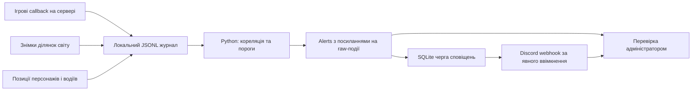

# Модель спостереження

Завдання — зробити видимими частину подій, відсутніх у стандартних логах, та
звузити пошук причини інциденту. Воно не зводиться до читання старих логів:
серверний addon створює нові спостереження у власному журналі.

## Атрибуція

| Джерело | Що воно встановлює | Чого не встановлює |
|---|---|---|
| `entity_init` | Спрацьовував OnPostInit editable-компонента | Хто запитав spawn та чи це чит |
| `scan_new` | Об'єкт з'явився у повному знімку вже відомої ділянки | Що це новостворений об'єкт; його автора |
| `server_action_callback` | Серверна функція пов'язала розміщення з гравцем | Що кожен мод/попередній RPC перевірив відправника правильно |
| `engine_instigator` | Рушій повідомив ID ініціатора пошкодження/тригера | Що він безпосередньо спричинив вибух або використовує стороннє ПЗ |
| `server_movement_sample` | Позиція персонажа або транспорт водія змінилися між двома серверними вимірами | Хто ініціював зміну; чи це нелегальний телепорт, а не фізика/GM/корекція |
| `gm_authorized` | Успішний GM-placement з перевіркою mode/manager/ролі або явний серверний зв'язок FX | Що адміністратор не зловживає правами; що всі моди/RPC безпомилкові |
| `gm_origin` | Джерело ефекту пов'язане з раніше створеним GM-об'єктом | Дозвіл на цей ефект або право всіх наступних користувачів об'єкта |

`GetAuthorPlayerID()` editable-об'єкта навмисно не використовується як доказ:
це може бути автор останньої зміни, а не початкового spawn. Власник реплікації,
найближчий гравець і гравець, довкола якого сканували світ, теж не вважаються
авторами. У spatial-події навіть не записується ID гравця, що визначив ділянку.

Для штатного editor-placement ID береться з серверного manager після створення,
а не безпосередньо з довільного параметра нового RPC. Для Conflict він визначається
за `user` у callback. Код цього проєкту не створює жодних RPC endpoint.

UID кешується тільки після `OnPlayerAuditSuccess` і видаляється при disconnect.
Для engine instigator залишається тільки повідомлений session player ID: старий
снаряд може пережити вихід гравця й повторне використання слота. Не приписуйте
такий ID поточному власнику слота без історії сесії. Secondary explosions можуть
успадковувати непрямого ініціатора.

## Кореляція і початковий стан

При ініціалізації об'єкта записується спостереження; його transform уточнюється
при flush, якщо об'єкт ще існує. Тому координати `entity_init` можуть відповідати
моменту flush, а не точній миті spawn. Для damage координати беруться з контексту
пошкодження без відкладеного уточнення.

Аналізатор очікує 2500 мс event time для зіставлення init із відомим placement
того самого об'єкта або ancestor композиції. Старий action поза цим інтервалом
не робить майбутні дочірні об'єкти легальними. Відомий маршрут усуває лише правило
«невідомий шлях», але не правило надмірної кількості spawn.

Перші 60 с — warmup. Усі raw-події залишаються в журналі. Перше повне сканування
ділянки встановлює baseline, не позначаючи будівлі карти як нові. Після перерви
понад 120 с або витіснення з кешу ділянка знову проходить baseline. Неповний запит
ніколи не використовується для diff: попередній baseline вилучається, а журнал
містить `scan_incomplete`.

Скануються клітинки 150 × 150 м, в яких перебувають контрольовані гравцями entity,
по одній за tick, з обходом гравців по черзі. Нижня/верхня межі Y: −1000 / 9000 м.
Повторне сканування тієї самої ділянки відбувається не частіше ніж раз на 5 с.
Знімок включає root-об'єкти з prefab і категорією GENERIC/UNCLASSIFIED; персонажі
та техніка вилучаються з цього сенсора, але можуть бути видимими іншим hooks.
Не всі native entities беруть участь у просторових запитах.

## Що потрібно перевіряти вручну

1. Знайти raw-події за `session` + `evidence_seq` і перевірити час/координати.
2. Перевірити prefab, карту, сценарій, штатне будівництво, GM та моди.
3. Для повідомленого гравця перевірити джерело атрибуції й історію його сесії.
4. Зіставити з відео/діями адміністратора, damage/kill подіями та станом світу.
5. Якщо подія справді несанкціонована, виправляти перевірку серверних дозволів
   у відповідному моді/RPC, а не лише додавати покарання до детектора.

Підвищення порога зменшує шум, але також збільшує кількість пропущених випадків.
Низька частота зловживань, події на межах клітинок, розподіл по карті й дуже
короткоживучі об'єкти можуть не створити alert. Raw-події, якщо сенсор їх побачив,
залишаються доступними для розслідування.

## Межі довіри та продуктивності

- Стандартний server-authoritative damage hook не покриває всі нативні ефекти.
- Пряме native створення без editable-компонента може залишитися лише сканеру.
- Інший modded override без `super` може обійти hook. Перевірка зі всіма модами обов'язкова.
- Клієнтський візуальний спам без серверного стану/пошкодження потребує інших
  джерел спостереження; цей код не сканує пам'ять чи процеси клієнта.
- Якщо зловмисник виконує довільний код на сервері, локальні журнали й hooks не
  є надійною межею захисту. Віддалений захищений колектор тут не реалізований.
- Переповнення черги, пропуски seq, неповні знімки та зупинка потоку мають
  операційні сигнали. Відсутність alert не означає відсутності інциденту.
- Обмеження роботи сканера не замінює профілювання FPS. Python можна запускати
  на іншому хості з копіями журналів, щоб не забирати CPU ігрового процесу.

Серверну частину не слід тримати безперервно понад 24 доби без перевірки поведінки
32-bit `System.GetTickCount` у цільовій збірці: тест переповнення лічильника в грі
не виконано. Негативний час аналізатор відхилить із явною помилкою.

## Сповіщення і рух

[Сенсор руху](MOVEMENT_UK.md) веде окремий baseline для кожного гравця; він не
використовує найближчого до події гравця як автора. Два виміри не відтворюють
повний шлях і не доводять використання стороннього ПЗ.

[Discord notifier](DISCORD_UK.md) читає alerts, перетворює їх на короткі
повідомлення й зберігає їх у SQLite. Зміна offset вхідного файлу та додавання
до черги — одна транзакція. Підтверджені `alert_id` зберігаються між запусками.
HTTP-доставка й SQLite-транзакція не можуть бути атомарними разом: після
прийняття повідомлення Discord, але до локального підтвердження, аварія може
дати повтор. Стабільний `alert_id` у тексті дозволяє його розпізнати.

Webhook дає право допису до вибраного каналу; він не дає notifier доступу до
ігрового сервера. Жодної команди виконання дій або покарання з Discord немає.

Два правила масового спавну мають спільний cooldown у клітинці та класі дозволу.
У повідомленні зберігається конкретна причина першого спрацювання; raw-події
продовжують записуватись. Watchlist і spatial_changes лишаються окремими
сигналами зі своїм змістом. Типи об'єктів — метадані групи, не критерій винуватості.

Підтверджені адміністративні операції рахуються окремо від непідтверджених.
Винятків за близькістю до адміністратора чи радіусом його удару немає.
Будь-яке підвищення статусу повинно спиратися на конкретний серверний маршрут
та об'єкт; [деталі GM](ADMIN_ACTIONS_UK.md).
